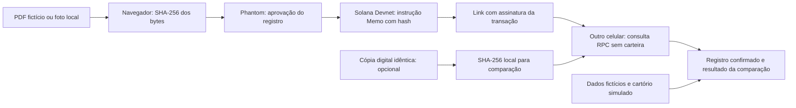

> **Atualização — etapa 2:** frontend React/TypeScript/Vite, quatro telas, seleção local, scripts, lockfile e seis testes implementados. Operações ainda simuladas; Phantom, SHA-256, transação/consulta Solana e publicação Vercel continuam pendentes. Aguardar o teste do autor. Ver [frontend/README.md](../frontend/README.md). Notas abaixo sobre frontend inexistente descrevem o estado anterior à etapa 2.

# Arquitetura atual — Solana Devnet

Fonte de verdade: [SPEC.md](../SPEC.md). A escolha anterior Sepolia/Solidity foi substituída por decisão expressa do autor.

## Decisões

| Tema | Decisão atual |
|---|---|
| Frontend | React + TypeScript + Vite implementados na etapa 2; integração Solana pendente; protótipo HTML separado como referência |
| Blockchain | Solana Devnet; SOL de teste |
| Carteira | Uma Phantom para registrar; nenhuma para consultar |
| Bibliotecas | Solana AI Kit, @solana/kit e integração atual da Phantom, com compatibilidade conferida antes da implementação |
| Hash | SHA-256 no navegador sobre o arquivo original, sem normalização |
| Escrita | Memo `propertychain:v1:sha256:<64 caracteres hex minúsculos>` |
| Programa próprio | Nenhum; usar programa Memo existente |
| Validação por cartório | Somente UI simulada, sem assinatura ou aprovação on-chain |
| Dados pessoais/foto | Não enviados; sem OCR, upload ou armazenamento remoto |
| Compartilhamento | Assinatura da transação em link público de consulta |
| Publicação | Repositório GitHub único e frontend na Vercel |

## Fonte de cada informação

- A transação fornece assinatura, sucesso/erro, instrução Memo, hash e metadados públicos de rede.
- O arquivo local fornece o hash esperado para comparação. Sem arquivo, só se confirma a existência do registro, não integridade de uma imagem específica.
- O JSON da fixture fornece Maria Oliveira, endereço, tipo e histórico **fictícios**. Só usar esses dados para o exemplo cujo hash coincide com a fixture; nunca por confiar num parâmetro de URL dizendo que o arquivo é fictício.
- “Cartório de exemplo” é uma demonstração visual; o endereço da carteira registrante não é certificado como cartório ou titular.

## Contrato da consulta

Validar assinatura e rede; buscar a transação em Devnet; exigir sucesso (`meta.err == null`) e confirmação `confirmed` ou `finalized`; inspecionar a instrução do programa Memo esperado e validar prefixo/hash. Rejeitar valores ambíguos ou conflitantes.

Extrair o hash da instrução, não de texto arbitrário nos logs. Comparar ao arquivo local quando disponível. O link não é a fonte da verdade para hash, proprietário ou cartório.

Um resultado não encontrado, pendente, falho, incompatível ou divergente não vira confirmação positiva. Consulta é somente leitura; não solicita assinatura nem paga nova taxa.

## Privacidade e persistência

Não há banco de dados, API de upload nem serviço de OCR. Arquivos reais ficam em memória no navegador durante o teste. A rede recebe só o hash e seus próprios metadados públicos. O hash não anonimiza garantidamente o documento.

O link leva a assinatura da transação para que outro aparelho possa consultar sem localStorage compartilhado. O arquivo original precisa ser entregue ao terceiro fora do app para comparação exata. Devnet pode ter resets e disponibilidade variável; não prometer preservação permanente de evidência em rede de testes.

## Desempenho

Objetivo: consulta de registro confirmado em 1–5 segundos, sem garantia externa. Consultar uma transação diretamente; não varrer eventos/blocos. Separar código de carteira do caminho de leitura. Cache estático é permitido; não usar cache de resultado como substituto silencioso da verificação real.

Medir carregamento, seleção/hash, leitura RPC e envio/confirmação separadamente. Ver [PLANO_DE_TESTES.md](PLANO_DE_TESTES.md).

## Legado

`contracts/` contém o DocumentRegistry Solidity e seus testes locais. Não há prova de deploy público da fase anterior. Esse código não é apagado nem transformado em programa Solana; não integra o build Vercel. Ver [adr/0008-solana-devnet-mvp.md](adr/0008-solana-devnet-mvp.md).
