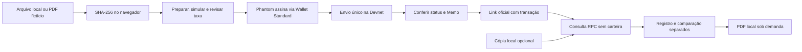

# Arquitetura atual — Solana Devnet

Revisão de 24/11/2026. Comportamento entregue, conforme [SPEC.md](../SPEC.md); não é uma proposta de integração futura.

## Estrutura executável

| Caminho | Responsabilidade |
|---|---|
| `frontend/src/App.tsx` | Entrada, rotas, perfis demonstrativos, cadastro e cartório simulado |
| `preparation.ts`, `PreparationPanel.tsx` | Hash local, conexão Phantom e RPC Devnet |
| `memo.ts`, `MemoRegistration.tsx`, `memo-errors.ts` | Preparação, revisão, assinatura, envio, confirmação, leitura do Memo e erros |
| `memo-record.ts` | Comprovante público pendente em sessionStorage e URL do explorador |
| `consultation-link.ts`, `PublicLookup.tsx` | Referência de consulta, compartilhamento oficial, leitura e comparação |
| `ExampleGuide.tsx` | Quatro etapas completas: anexo/hash locais, carteira/publicação ilustradas, cartório simulado, escolha de comparação e resultado/PDF |
| `NetworkHelp.tsx` | Explicações simples de blockchain e Phantom, instalação oficial e alternativa sem carteira |
| `VerificationOutcome.tsx` | Apresentação compartilhada de comparação, detalhes recolhidos, links e relatório |
| `verification-result.ts` | Resultado e mensagens de comparação compartilhadas com o PDF |
| `ReportDownload.tsx`, `verification-report.ts` | Geração local e abertura/download do PDF; biblioteca carregada sob demanda |
| `frontend/prototype/` | Referência visual histórica; não é o app publicado |
| `fixtures/` | PDF/JSON/TXT fictícios; não contém documentos pessoais |
| `contracts/` | Solidity/Hardhat legado, isolado do build Vercel |

Os arquivos curtos da tabela, exceto diretórios indicados, ficam em `frontend/src/`. Não há backend, banco de dados, upload, OCR, programa Solana próprio ou carteira de servidor. `scripts/bootstrap_github.sh` apenas lista issues com gh; não cria novo backlog.

## Bibliotecas e configuração

React/TypeScript/Vite; @solana/kit 8.6.0 e @wallet-standard/app 1.1.1; pdf-lib 1.17.1 para o relatório. Versões resolvidas estão no lockfile. O Solana AI Kit orientou a implementação em modo sem instalação; não é dependência runtime. Ver [referências](SOLANA_AI_KIT.md).

Devnet é conferida por genesis. A conexão usa o provedor oficial Phantom; a assinatura usa `solana:signTransaction` para `solana:devnet`. A mensagem v0 contém Compute Budget com preço de prioridade zero, seguido do Memo com o hash. Há taxa de rede em SOL de teste; não existe transferência para terceiros. A assinatura/mensagem são conferidas antes do envio.

## Consulta e origem dos dados

`lookupMemo` usa commitment confirmed na leitura da transação e verifica ausência de erro, pagador e instruções esperadas. Aceita o formato atual (Compute Budget zero + Memo) e o formato anterior de apenas Memo. Programa, prefixo, hash e conteúdo incompatíveis são rejeitados. O hash não é extraído de logs arbitrários nem confiado a parâmetros do link.

A assinatura identifica o registro; a cópia local produz o hash esperado. Resultado sem arquivo não compara integridade de uma imagem específica; arquivo diferente não é afirmação de fraude. A consulta pública não exibe proprietário/histórico do exemplo, mesmo que a fixture coincida. JSON fictício apoia o cadastro de exemplo; cartório é apenas apresentação visual.

## Exemplo guiado #61

A entrada seleciona o exemplo por padrão; `#exemplo` acompanha cadastro, cartório, verificação e resultado, com contador e navegação próprios. O cadastro tem estados de anexo, hash, conexão ilustrativa, aprovação/publicação ilustrada e registro existente conferido. O cartório tem estados anterior/posterior à aprovação somente visual. Carteira/publicação não acessam provedor, assinatura, envio ou sessionStorage. `lookupMemo` consulta a assinatura fixa do PDF fictício: hash do arquivo e hash da transação precisam corresponder à fixture. Para a cópia alterada, acrescenta um byte de quebra de linha em memória e calcula de novo; para a consulta sem arquivo, não fornece hash local. A fixture é carregada ao anexar e conferida no cálculo; a publicação ilustrada faz uma leitura do registro existente, e cada caso selecionado na etapa 3 faz outra leitura. O resultado e o PDF só são montados na etapa 4 e são descartados ao testar outro caso. A aprovação visual não é dado da transação nem do relatório. AbortController cancela/ignora resposta ao sair; bloqueio por ref evita clique duplicado. Não chama conexão, preparação ou envio de transação. Indisponibilidade da Devnet é erro com retry, sem resultado fictício.

## Persistência e relatório

Arquivo, resultado confirmado e PDF preparado ficam em memória. Apenas hash, pagador e assinatura da tentativa pendente são guardados em sessionStorage antes do envio. Um recarregamento pode retomar essa leitura, sem reenviar automaticamente. O comprovante pendente é limpo ao confirmar ou falhar conclusivamente.

PDF captura os dados de uma consulta confirmada, sem arquivo original/nome/titular e sem nova chamada RPC. Data/hora vem do relógio do aparelho, em UTC; não é timestamp certificado ou horário da transação. O URL Blob é temporário e liberado ao sair do resultado. Não há lista permanente de documentos ou relatórios.

## Publicação e limites

Vite gera `frontend/dist`; Vercel serve o frontend estático em HTTPS no [domínio público oficial](https://propertychain-theta.vercel.app/). Links compartilhados usam esse domínio, mesmo se o app foi aberto em um deploy temporário. URLs coladas são interpretadas localmente; não são visitadas pelo app.

A leitura direta de uma transação evita varredura de blocos. O tempo exibido mede RPC/conferência do Memo; o PDF carrega em chunk separado após solicitação. Não confundir metas de latência com garantias da rede ou com confirmação de uma transação nova. Devnet pode sofrer resets e indisponibilidade.

O legado EVM é testado em job separado; não fornece prova de integração Solana nem participa do deploy atual. Ver [CI](CI.md) e [ADR 0008](adr/0008-solana-devnet-mvp.md).
