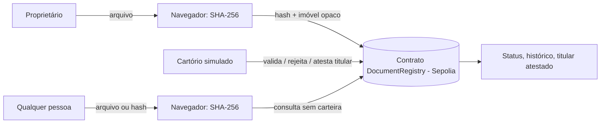
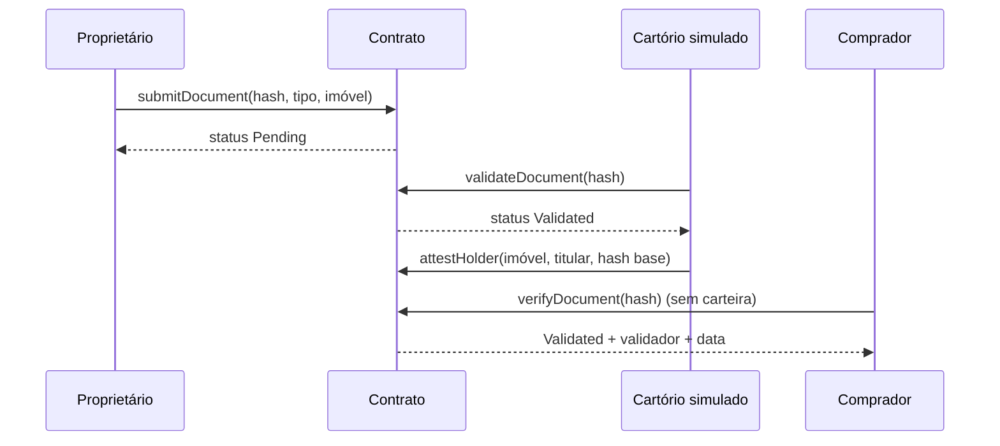

# Arquitetura

Rascunho para você revisar (issue #11).

## Visão geral



## Decisões

| Tema | Decisão | Motivo |
|------|---------|--------|
| Hash | SHA-256 calculado no navegador | Verificável por qualquer ferramenta (`sha256sum`); o arquivo não sai do computador |
| Rede | Sepolia (testnet) | Gratuita, adequada a protótipo, reforça "sem valor legal" |
| Contrato | Solidity + Hardhat + OpenZeppelin AccessControl | Padrão de mercado e boa documentação |
| Frontend | React + TypeScript + Vite + ethers v6 | Simples e comum |
| Token do imóvel | Não existe | Evita enquadramento como sistema paralelo (ver escopo jurídico) |
| Dados pessoais | Nunca em claro on-chain | LGPD e imutabilidade |
| Imóvel | `propertyRef = keccak256(matrícula + cartório + salt)` | Referência opaca |

## Modelo de dados (on-chain)

**Documento** (chave: `docHash`)

| Campo | Tipo | Observação |
|-------|------|-----------|
| docType | enum | matrícula, escritura, contrato de compra e venda, certidão, comprovante de posse, outro |
| propertyRef | bytes32 | referência opaca do imóvel |
| status | enum | None (hash não cadastrado), Pending, Validated, Rejected, Revoked |
| submitter / submittedAt | address / uint64 | quem e quando |
| reviewer / reviewedAt | address / uint64 | validador e data da decisão |
| reasonCode | uint8 | motivo de rejeição/revogação |
| cid | string | opcional, cópia criptografada fora da chain |

**Atestação de titular** (chave: `propertyRef`): lista de `{holder, basisDocHash, attestedBy, attestedAt}`.

## Interface do contrato (esboço)

```solidity
function submitDocument(bytes32 docHash, DocType docType, bytes32 propertyRef, string calldata cid) external;
function validateDocument(bytes32 docHash) external;                       // VALIDATOR
function rejectDocument(bytes32 docHash, uint8 reasonCode) external;       // VALIDATOR
function revokeDocument(bytes32 docHash, uint8 reasonCode) external;       // VALIDATOR
function attestHolder(bytes32 propertyRef, address holder, bytes32 basisDocHash) external; // VALIDATOR

function verifyDocument(bytes32 docHash) external view returns (Document memory); // status None = não encontrado
function getDocumentsByProperty(bytes32 propertyRef) external view returns (bytes32[] memory);
function getHolderHistory(bytes32 propertyRef) external view returns (HolderAttestation[] memory);
function latestAttestedHolder(bytes32 propertyRef) external view returns (address); // último titular atestado nos documentos; não indica propriedade legal
```

## Códigos de motivo (rascunho para fechar na issue #11)

| Código | Uso | Significado |
|--------|-----|-------------|
| 1 | rejeição | Documento ilegível ou incompleto |
| 2 | rejeição | Dados divergentes de outros documentos do imóvel |
| 3 | rejeição | Suspeita de adulteração ou fraude |
| 4 | rejeição / revogação | Documento substituído por versão mais recente |
| 5 | revogação | Decisão judicial ou administrativa |
| 6 | revogação | Erro de validação reconhecido pelo validador |
| 99 | ambos | Outro motivo |

## Eventos

`DocumentSubmitted`, `DocumentValidated`, `DocumentRejected`, `DocumentRevoked`, `HolderAttested`.

## Fluxo principal



## Leitura de dados no frontend

Consultas (`verifyDocument`, `getDocumentsByProperty`, `getHolderHistory`, `latestAttestedHolder`) usam um provedor somente leitura, sem carteira. Linha do tempo e lista de pendências são montadas a partir dos eventos do contrato, lidos em intervalos de blocos a partir do bloco de deploy, porque RPCs públicos limitam `getLogs` (issue #37).

## Riscos conhecidos

- **Ocupação de hash**: alguém submete antes o hash de um documento alheio. Mitigação: submissão nasce Pendente; só o validador confirma, e a tela mostra quem submeteu.
- **Garbage in, garbage out**: a blockchain não garante que o documento é verdadeiro; quem garante é a validação do cartório fora da chain.
- **Perda do salt**: sem ele, não é possível reconstruir a referência do imóvel.
- **Limite de eventos do RPC**: leitura de histórico longo pode falhar em RPC público. Mitigação: paginação por blocos e bloco de deploy em configuração (#37).
